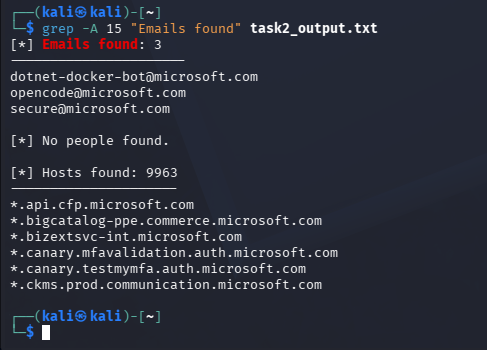

# Footprinting & Reconnaissance with theHarvester

NetworkWalks Cybersecurity Internship – Week 2

Intern: Tanvi Mathur

Batch: B084J

Date: 14 November 2026

Week 2 | Project Module 4: Cybersecurity & Ethical Hacking

> **For educational purposes only.** This lab used passive reconnaissance against a public domain (`microsoft.com`), in a lab environment, using publicly available sources only. No systems were accessed or attacked.

## Overview

The Harvester is an open source intelligence tool used to gather email addresses, sub-domains, hosts, IP Addresses and employee names from publicly available sources like search engines and certificate databases. It can never actively interact with its target as it only uses information from public sources making it very difficult to identify passive reconnaissance.
In this lab we have used theHarvester to gather email IDs and sub-domains from microsoft.com in two different source configurations.

## Environment

| Item | Detail |
|---|---|
| Operating system | Kali Linux |
| Tool | theHarvester 4.11.1 |
| Target | microsoft.com |
| Type of recon | Passive (public sources only) |

## Tasks and commands

### Task 1: Baidu, limit 1000

```bash
theHarvester -d microsoft.com -l 1000 -b baidu | tee task1_output.txt
```

- `-d` sets the target domain
- `-l` limits the number of results
- `-b` sets the data source
- `tee` shows the output on screen and saves it to a text file

**Results:** 3 emails and 12 hosts.

Emails found:
- mscomblg@microsoft.com
- projectrometeam@microsoft.com
- vs-irl@microsoft.com


### Task 2: All sources, limit 50

```bash
theHarvester -d microsoft.com -l 50 -b all | tee task2_output.txt
```

**Results:** 3 emails, 111 IP addresses and 9,963 hosts (sub-domains).

Emails found:
- dotnet-docker-bot@microsoft.com
- opencode@microsoft.com
- secure@microsoft.com




## Repository contents

```
.
├── README.md
├── Networkwalks_week2_lab.docx   Full report with all screenshots
├── task1_output.txt              Saved output for Task 1
├── task2_output.txt              Saved output for Task 2
└── *.png                         Evidence screenshots for both tasks
```

## Observations

The results vary depending on the source. Baidu provided a couple of hosts but the overall result gave thousands of sub-domains.
Some sources provided an error message saying "Missing API key". The sources require you to have a paid or registered API key which is why they were skipped. However, adding a key would likely provide more information.

Due to public sources constantly updating there data and algorithms results may vary.

## Why this matters

-Harvested email addresses can be used for phishing and password attacks.

-Sub-domains increase the attack surface. These could contain systems that were forgotten about and testing systems.

-Defenders will run the tool inside their organisation so that they know what an attacker would see. They will then reduce what information is published.

## Key takeaways
-Passive reconnaissance collects a large amount of information, without any contact with the target.
-The less that is known about an organisation publically, the harder it will be to carry out all aspects of the attack.

