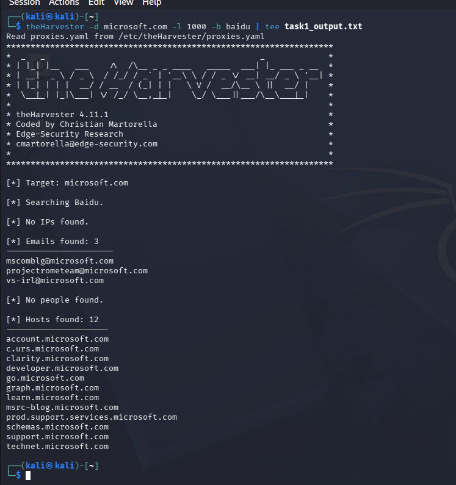

# Footprinting & Reconnaissance with theHarvester

Week 2 | Project Module 4: Cybersecurity & Ethical Hacking

> **For educational purposes only.** This lab used passive reconnaissance against a public domain (`microsoft.com`), in a lab environment, using publicly available sources only. No systems were accessed or attacked.

## Overview

theHarvester is an open source intelligence (OSINT) tool that collects emails, sub-domains, hosts, IP addresses and employee names from public sources such as search engines and certificate databases. Because it only reads public data, it never touches the target directly, which makes this kind of passive recon hard to detect.

In this lab I used theHarvester to gather email IDs and sub-domains for `microsoft.com` with two different source settings.

## Environment

| Item | Detail |
|---|---|
| Operating system | Kali Linux |
| Tool | theHarvester 4.11.1 |
| Target | microsoft.com |
| Type of recon | Passive (public sources only) |

## Tasks and commands

### Task 1: Baidu, limit 1000

```bash
theHarvester -d microsoft.com -l 1000 -b baidu | tee task1_output.txt
```

- `-d` sets the target domain
- `-l` limits the number of results
- `-b` sets the data source
- `tee` shows the output on screen and saves it to a text file

**Results:** 3 emails and 12 hosts.

Emails found:
- mscomblg@microsoft.com
- projectrometeam@microsoft.com
- vs-irl@microsoft.com



### Task 2: All sources, limit 50

```bash
theHarvester -d microsoft.com -l 50 -b all | tee task2_output.txt
```

**Results:** 3 emails, 111 IP addresses and 9,963 hosts (sub-domains).

Emails found:
- dotnet-docker-bot@microsoft.com
- opencode@microsoft.com
- secure@microsoft.com


## Repository contents

```
.
├── README.md
├── Networkwalks_week2_lab.docx   Full report with all screenshots
├── task1_output.txt              Saved output for Task 1
├── task2_output.txt              Saved output for Task 2
└── *.png                         Evidence screenshots for both tasks
```

## Observations

- Different sources return very different results. Baidu returned only a few hosts, while the all-sources run returned thousands of sub-domains.
- Some sources showed `Missing API key` messages. These sources need paid or registered API keys, so theHarvester skipped them. Adding keys would likely return even more data.
- Results can change between runs because the public sources keep changing their data and algorithms.

## Why this matters

- Harvested emails can be used for phishing and password attacks.
- Sub-domains widen the attack surface and can include forgotten or test systems.
- Defenders run the same tool on their own organization to see what an attacker would see, then reduce what they expose publicly.

## Key takeaways

- Passive reconnaissance gathers a lot of information without ever contacting the target.
- Trying more than one data source gives a fuller picture.
- The less an organization exposes publicly, the harder every later stage of an attack becomes.

## Disclaimer

This material is for education and research only. Only test systems you own, have written permission to test, or that are part of a lab environment. Unauthorised access is illegal in most countries.
